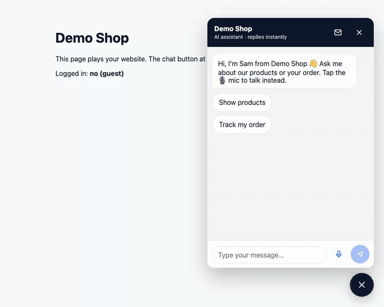
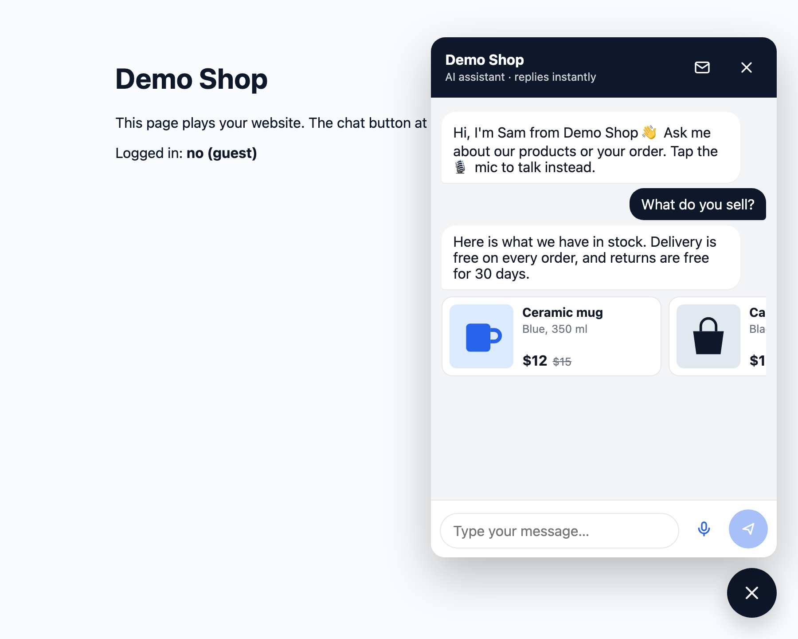
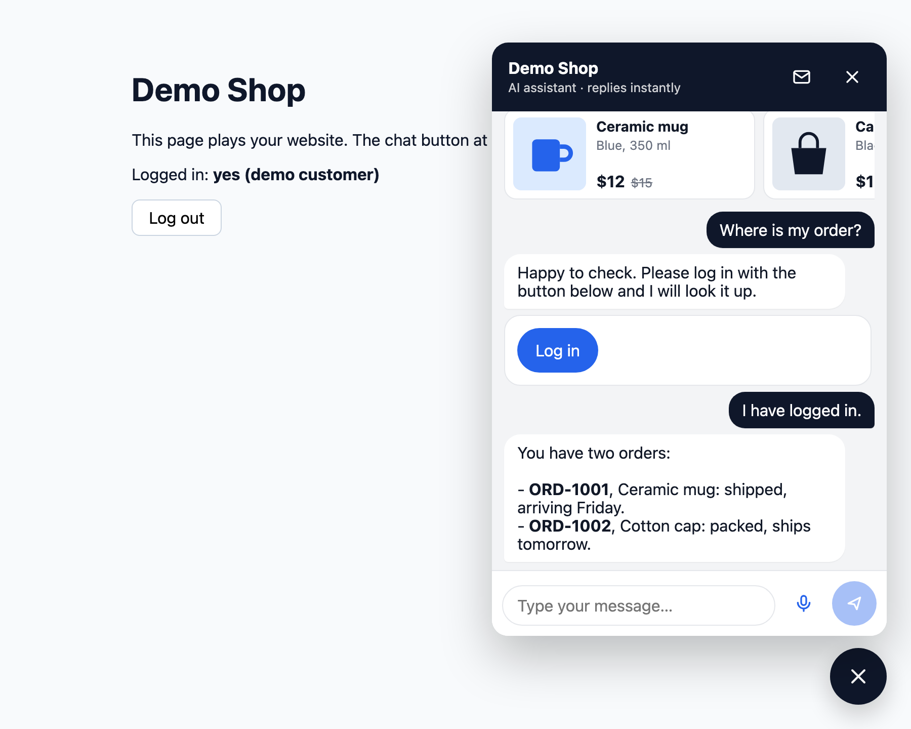

# agentdesk

**A self-hosted AI support agent for your website and WhatsApp: a chat widget with live voice calls, and your WhatsApp number, running your own tools.**



Add one `<script>` tag to your site and visitors get a chat button. They type, or tap 🎙 and talk, to an AI agent (Claude for text, Gemini Live for voice) that answers from *your* tools: products, orders, bookings, whatever your MCP server exposes. Logged-in visitors get answers about their own account; guests get a "Log in" button when they need one. Your team can read every chat and reply from the admin API.

The same agent answers on WhatsApp too: photos, voice notes, catalog messages and all ([docs/whatsapp.md](docs/whatsapp.md)).

## Features

- **One script tag.** Works on any site (plain HTML, WordPress, Shopify, Next.js). The widget draws inside a shadow root, so your CSS and its CSS never mix. ~50 KB (Preact).
- **Your tools over MCP.** Point agentdesk at any MCP server (Streamable HTTP). No tool code lives in agentdesk.
- **Live voice calls.** Gemini Live, straight from the browser with a one-use token. The prompt, tools and model are locked into the token, so it can't be reused for anything else. The transcript lands in the chat.
- **Logged-in visitors.** Your site signs a short-lived identity token; agentdesk passes per-user values to your tools as hidden arguments the model never sees or sets.
- **Cards.** A tool can return product (or any) cards: photo, title, price, link.
- **WhatsApp.** Your Business number through Meta's Cloud API: photos the agent can see, voice notes in and out, cards as catalog messages ([docs/whatsapp.md](docs/whatsapp.md)).
- **Your team in the loop.** List chats, read them with every tool call, and reply as a person.
- **Built for real traffic.** A newer message cancels the running reply, prompt caching across visitors, rate limits per chat, IP and day, error alerts to Slack.

<table>
  <tr>
    <td></td>
    <td></td>
  </tr>
</table>

## Quick start (5 minutes, no database)

You need Node 22+ and an [Anthropic API key](https://console.anthropic.com/).

```bash
git clone https://github.com/abhijeet-maharana/agentdesk && cd agentdesk
npm install
cp agentdesk.config.example.yaml agentdesk.config.yaml
export ANTHROPIC_API_KEY=sk-ant-...
export IDENTITY_SECRET=$(openssl rand -hex 32)   # shared by the demo shop and agentdesk

npm run demo:tools   # terminal 1: a pretend shop with an MCP server, on :8090
npm run dev          # terminal 2: agentdesk, on :8080
```

Open http://localhost:8090, tap **Chat with us**, ask "what do you sell?", then "where is my order?" and log in when asked.

Add `GEMINI_API_KEY` to try voice calls. Without `DATABASE_URL` chats live in memory; set it (any Postgres) to keep them.

## Put it on your site

```html
<script src="https://chat.example.com/widget.js" async></script>
```

That's all for guests. To let logged-in visitors ask about their own account, sign an identity token on your server and hand it to the widget:

```html
<script src="https://chat.example.com/widget.js" data-manual></script>
<script>
  AgentDesk.init({
    identity: () => fetch('/api/chat-token').then((r) => r.json()).then((d) => d.token),
    onLogin: () => openMyLoginDialog(), // resolve true once they're logged in
  });
</script>
```

Call `AgentDesk.reset()` when someone signs out. Full guide, including how to sign the token: [docs/embedding.md](docs/embedding.md).

## Your tools

agentdesk talks to one MCP server (`mcp.url`). Three conventions on top of plain MCP:

| Convention | What it does |
|---|---|
| `mcp.hiddenArgs: [user_token]` | agentdesk fills these arguments itself and removes them from the schema the model sees. Values come from the customer's identity token (`toolArgs`), else the built-ins `channel` (`web` or `whatsapp`), `conversation_id` and `phone` (WhatsApp), else `""`. Your tool trusts them; the model can't spoof them. |
| `structuredContent: { cards: [...] }` | Shown as cards under the reply. Each card: `id`, `title`, `url`, and optional `subtitle`, `price`, `originalPrice`, `image`. A numeric price gets the widget's currency. |
| `mcp.promptResource: your://instructions` | A resource whose text is added to the agent's instructions, so the prompt can live with your tools. |

The demo in [examples/demo-tools/server.ts](examples/demo-tools/server.ts) uses all three.

## Configure

Everything non-secret lives in `agentdesk.config.yaml`; [agentdesk.config.example.yaml](agentdesk.config.example.yaml) lists every option with a comment. `${NAME}` in the file is replaced with the environment variable `NAME`.

Secrets come only from the environment ([.env.example](.env.example)). Each can also be set as `AGENTDESK_<NAME>` (which wins), for when agentdesk shares an env file with your app:

| Variable | Needed for |
|---|---|
| `ANTHROPIC_API_KEY` | Typed chat (required) |
| `DATABASE_URL` | Keeping chats (Postgres). One table, `agentdesk_messages`, created on start |
| `GEMINI_API_KEY` | Voice calls (with a `voice:` section in the config) |
| `IDENTITY_SECRET` | Logged-in visitors (HS256 identity tokens) |
| `ADMIN_TOKEN` | The admin API |
| `ALERT_WEBHOOK_URL` | Error alerts to a Slack-compatible webhook |
| `WHATSAPP_TOKEN`, `WHATSAPP_APP_SECRET`, `WHATSAPP_VERIFY_TOKEN` | The WhatsApp channel ([docs/whatsapp.md](docs/whatsapp.md)) |
| `AUDIO_API_KEY` | WhatsApp voice notes (`whatsapp.audio`) |

## Run in production

```bash
docker compose up -d   # agentdesk + Postgres; reads .env and agentdesk.config.yaml
```

Put it behind your reverse proxy with HTTPS (the microphone needs a secure page) and set `trustProxy: true` so rate limits see real IPs. agentdesk keeps live state (running replies, voice calls, rate limits) in memory, so run **one** instance.

## Admin API

`Authorization: Bearer $ADMIN_TOKEN` on every call.

| Call | Does |
|---|---|
| `GET /v1/admin/conversations?limit=50` | Latest chats |
| `GET /v1/admin/conversations/:key` | One chat, with every tool call and its raw result |
| `POST /v1/admin/conversations/:key/messages` `{ "text": "..." }` | Reply as your team (shown with `teamLabel`; sent on WhatsApp for `whatsapp:` chats) |
| `POST /v1/admin/conversations/:key/context` `{ "text": "...", "ref"?: "..." }` | Something your app sent the customer itself; the agent reads it, nothing is sent |
| `POST /v1/admin/whatsapp/webhook` | Pass on a Meta webhook body your own app received ([docs/whatsapp.md](docs/whatsapp.md)) |

## How it works

1. The browser keeps a random conversation id in localStorage and posts the visitor's message. agentdesk stores it and returns at once; the agent runs in the background (replies can take 10–40 s with several tool rounds).
2. The agent loop calls Claude, runs the tools it asks for (identical calls answered from a cache), and repeats until it writes a reply. A newer message cancels the run; the newer run answers both.
3. The widget polls: every 1.5 s while a reply is coming, every 20 s while open (to pick up team replies), never while closed.
4. 🎙 asks agentdesk for a voice call. It builds the same prompt plus the last 10 turns, locks it with your tools into a one-use Gemini token, and the browser talks to Gemini directly (no audio through your server). Gemini's tool calls come back through agentdesk, as the same visitor. The transcript is saved when the call ends.

## Develop

```bash
npm run dev          # server with reload (builds the widget once)
npm run dev:widget   # rebuild the widget on change
npm test             # set TEST_DATABASE_URL to also test the Postgres store
npm run typecheck && npm run lint
npm run screenshots  # redraws docs/media (demo shop + a scripted model; needs ffmpeg)
```

Pull requests welcome: see [CONTRIBUTING.md](CONTRIBUTING.md).

## License

MIT
