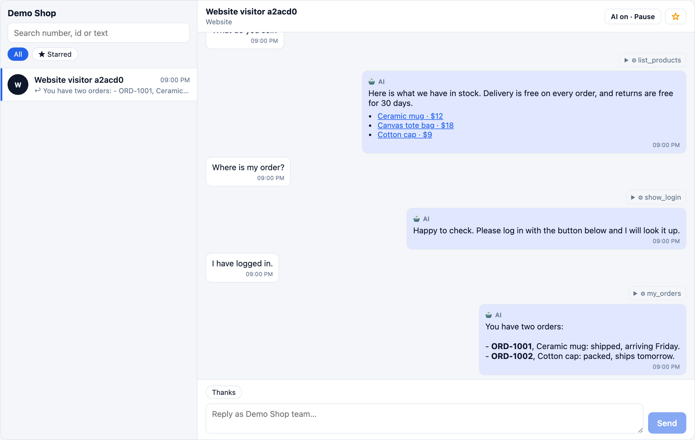

# Inbox

Your team's view of every chat, website and WhatsApp: read them with each tool call, reply, pause the agent while you talk to the customer, star, search. One script, `inbox.js`, draws it, both on agentdesk's own page and inside your admin.



## agentdesk's own page

Open `https://<your agentdesk>/inbox` and paste your `ADMIN_TOKEN`. It stays in that browser tab only.

## Inside your own admin

```html
<div id="inbox" style="height: 80vh"></div>
<script src="https://chat.example.com/inbox.js"></script>
<script>
  AgentDeskInbox.mount(document.getElementById('inbox'), {
    token: () => fetch('/api/agentdesk-staff-token').then((r) => r.json()).then((d) => d.token),
  });
</script>
```

Add your admin's origin to the config, so the browser may call agentdesk:

```yaml
inbox:
  allowedOrigins: ["https://admin.example.com"]
  quickReplies:
    - { label: "Ask for a review", text: "Glad we could help! Would you leave us a review? https://…" }
```

### The staff token

`ADMIN_TOKEN` must never reach a browser. Your server signs a short-lived token for whoever is logged in to your admin, with the same `IDENTITY_SECRET` as visitor identity tokens and the audience `agentdesk-inbox`:

```js
import { SignJWT } from 'jose';
const token = await new SignJWT({ name: user.name, role: 'agent' }) // or 'viewer': read only
  .setProtectedHeader({ alg: 'HS256' })
  .setSubject(user.id)
  .setAudience('agentdesk-inbox')
  .setExpirationTime('1h')
  .sign(new TextEncoder().encode(process.env.IDENTITY_SECRET));
```

A visitor's identity token is never accepted as a staff token, nor the other way round.

### Your own parts

| Option | What it does |
|---|---|
| `onSend(conversation, text)` | Sends team replies your way (e.g. a template when WhatsApp's 24-hour window is closed). Default: agentdesk sends it |
| `actions: [{ label, run(conversation) }]` | Buttons in the chat header, e.g. "Send catalog" |
| `panel(conversation, element)` | Your side panel for the open chat (customer details, tickets). Draw into `element` with anything you like; it lives in your page, so your CSS applies. Return a cleanup function if you need one |
| `theme: { bg, surface, border, text, muted, accent, … }` | Colours (`--ib-*` in [inbox.css](../widget/src/inbox/inbox.css)), e.g. to match a dark admin |
| `conversation: "whatsapp:9198…"` | Open this chat first |

## What the inbox shows

- **List:** newest first, unread count (the customer's messages since your team last opened the chat), star, ⏸ while the agent is paused. Search covers the number or id and every message. Filters: starred, channel.
- **Chat:** customer messages, the agent's replies (with cards), team replies, messages your app sent (`context`), every tool call with its input and raw result, photos and voice notes (through `/v1/admin/media/:id`), and WhatsApp's 24-hour window.
- **Actions:** reply, quick replies, Pause / Resume the agent (12 hours), star. Opening a chat marks it read.

Polls every 10 s (list) and 5 s (open chat).
